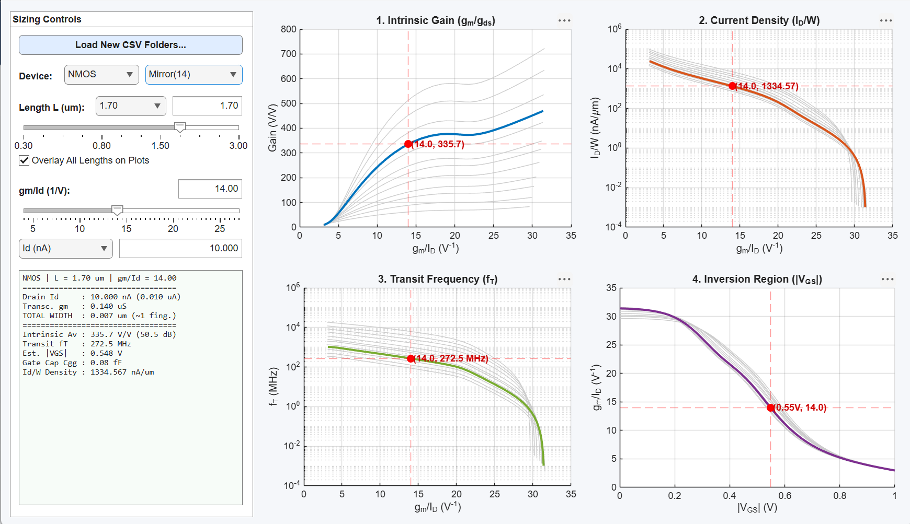
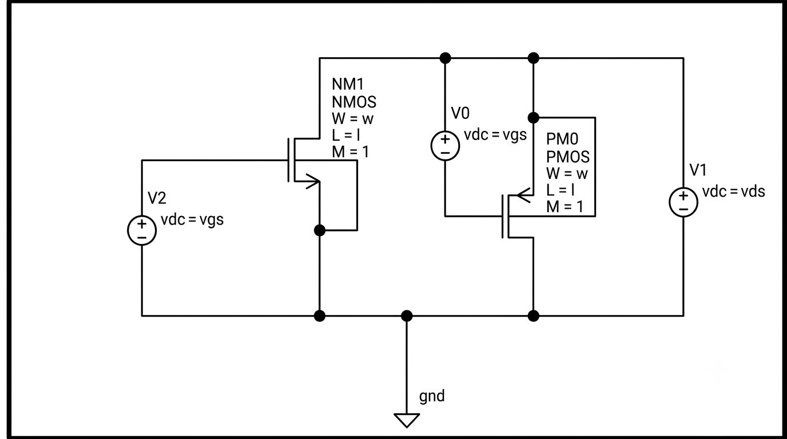

# gmId-Analog-RF-Sizing-tool
**A PDK-Agnostic MATLAB GUI for Automated $g_m/I_D$-Based Analog & RF Circuit Sizing from Cadence Spectre Sweeps**

## Why This Tool?
Traditional square-law hand calculations ($I_D = \frac{1}{2}\mu C_{ox}\frac{W}{L}(V_{GS}-V_{th})^2$) break down in weak and moderate inversion, forcing analog designers into tedious trial-and-error iterations in Cadence Virtuoso.

**`gmId_Sizing_tool.m`** automates the $g_m/I_D$ design methodology by parsing raw Cadence Spectre `.vcsv` DC sweeps into an interactive 2D-interpolated Lookup Table (`pchip` across both channel length $L$ and $g_m/I_D$).

### Key Features
* **PDK-Agnostic & Auto-Aligning:** Automatically parses any number of `<L>.vcsv` and `<L>gm.vcsv` sweep files from any PDK (`gpdk180`, `gpdk90`, `gpdk45`, `sky130`, etc.), regardless of Cadence column export order.
* **Triple-Synced Length ($L$) Control:** Choose extracted lengths via dropdown or indexed slider, or type any intermediate length (e.g., `1.35 µm`) for live 2D interpolation.
* **Analog & RF Biasing Presets:** One-click $g_m/I_D$ presets for Subthreshold Diff Pairs (`24`), Active Loads (`18`), Current Mirrors (`14`), RF LNAs (`10`), and Mixers/VCOs (`7`).
* **Bidirectional Solver:** Enter target current ($I_D$ in nA/µA) or target transconductance ($g_m$ in µS/mS) to instantly calculate width ($W$), finger count, gate capacitance ($C_{gg}$), and $|V_{GS}|$.
* **4 Real-Time Diagnostic Curves:** Live crosshairs and `(X, Y)` callouts for **Intrinsic Gain ($g_m/g_{ds}$)**, **Current Density ($I_D/W$)**, **Transit Frequency ($f_T$)**, and **Inversion Region ($g_m/I_D$ vs. $|V_{GS}|$)**, plus a multi-length overlay toggle.

---

## How to Extract `.vcsv` Curves in Cadence Virtuoso (ADE L / Explorer)

### 1. Single-Sweep NMOS & PMOS Testbench Setup
Wire `NM1` (NMOS) and `PM0` (PMOS) with shared `vgs` and `vds` design variables (`W = w`, `L = l`, `M = 1`) as shown below:

* **How It Works:** `V1` (`vdc = vds`) sets $V_{DS}$ for `NM1` and $|V_{DS}|$ for `PM0` simultaneously. `V2` (`vdc = vgs`) sets $V_{GS}$ for `NM1`, while `V0` (`vdc = vgs`) is referenced to the top `vds` rail so $|V_{GS}| = v_{gs}$ for `PM0` using a single positive sweep variable.
* **Design Variables:** `w = 10u`, `l = 500n`, `vgs = 500m`, `vds = 500m`.

### 2. Save DC Operating Points
1. Open **Launch → ADE L** (or **ADE Explorer**).
2. Click **Analyses → Choose... → `dc`**, enable **Save DC Operating Point**, set **Sweep Variable** to **`Design Variable`**, enter **`vgs`**, sweep **`0` to `1`** (Linear step `20m`), and click **OK**.
3. Go to **Outputs → To Be Saved → Select OP Parameters...**, click both **`NM1`** and **`PM0`**, and add: `gm`, `gds`, `id`, `gmoverid`, `cgg`.
4. Click **Netlist and Run** once.

### 3. Calculator Expressions (`waveVsWave`)
Open **Tools → Calculator**, select `os` (Operating Point Sweep) to extract `gm`, `gds`, `id`, `gmoverid`, `cgg`, and select `var` (Variable) to extract width (`w`) into the stack. Send these expressions to ADE Outputs:
* **Intrinsic Gain vs. $g_m/I_D$:** `waveVsWave(?x OS("/NM1" "gmoverid") ?y (OS("/NM1" "gm") / OS("/NM1" "gds")))`
* **Current Density vs. $g_m/I_D$:** `waveVsWave(?x OS("/NM1" "gmoverid") ?y (OS("/NM1" "id") / VAR("w")))`
* **Transit Frequency vs. $g_m/I_D$:** `waveVsWave(?x OS("/NM1" "gmoverid") ?y (OS("/NM1" "gm") / (2 * 3.14159 * OS("/NM1" "cgg"))))`
* **$g_m/I_D$ vs. $V_{GS}$:** `OS("/NM1" "gmoverid")`

*(Repeat the same 4 expressions replacing `/NM1` with `/PM0` for PMOS).*

### 4. Sweep $L$ & Export `.vcsv`
1. Sweep `l` via **Tools → Parametric Analysis** (e.g., `300n` to `3u`).
2. For each length `<L>` (e.g., `600n`), export the first 3 curves as **`600n.vcsv`** and the $g_m/I_D$ vs. $V_{GS}$ curve as **`600ngm.vcsv`** into separate `nmos/` and `pmos/` folders.

---

## Running the Tool
1. Open MATLAB (R2020b or newer) and run **`gmId_Sizing_tool.m`**.
2. Select your `nmos/` and `pmos/` folders in the pop-up dialog (`PDK_LUT.mat` is cached automatically for instant future launches).
